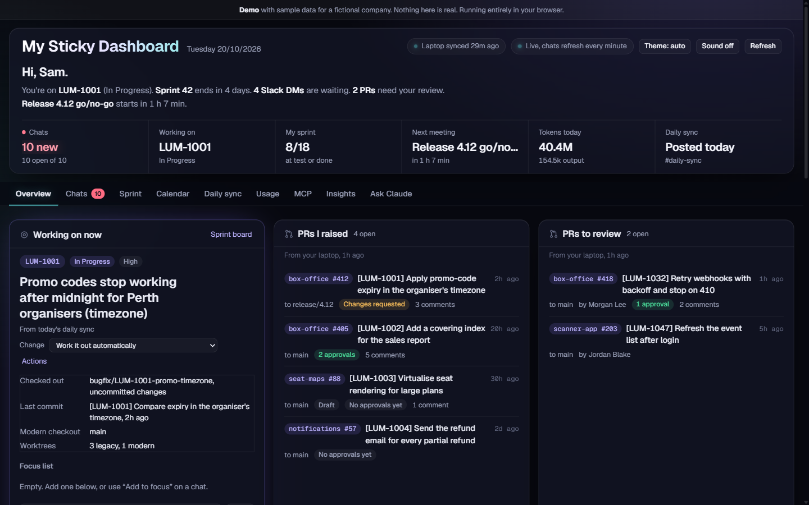

### Hi, I'm Jovan 👋

Senior full-stack engineer on a live ticketing and payments platform. I work across a large .NET monolith and its migration to a modern .NET and Next.js stack: APIs, SQL, payments, infrastructure, and the incidents that come with them.

I use **Claude Code** as a daily engineering tool, not just for autocomplete. I've built a workflow around it so the agent's output gets checked as hard as a colleague's PR would be.

#### Start here

- **[My Sticky Dashboard: live demo](https://jovanmb.github.io/my-sticky-dashboard-demo/)**: the work dashboard I use every day, rebuilt on sample data and running in your browser. Behind it are a typed API on SQLite, 38 unit and API tests, 8 Playwright tests and CI.
- **[AI engineering notes](https://jovanmb.github.io/ai-engineering-notes/)**: write-ups from real work.
  - [Twelve times I corrected the AI](https://jovanmb.github.io/ai-engineering-notes/decisions.html): bugs in AI-written code that looked correct, and how each was caught.
  - [An AI reviewer on a PR with a planted bug](https://jovanmb.github.io/ai-engineering-notes/pr-review-case-study.html): it found the planted SQL injection, then two real bugs I hadn't planted.
  - [An AI reviewer on a retry change that passes every test](https://jovanmb.github.io/ai-engineering-notes/retry-case-study.html): it found the planted double-post, then a hanging-request bug I'd written without noticing.
  - [How my AI workflow evolved](https://jovanmb.github.io/ai-engineering-notes/workflow-evolution.html): sixteen rewrites, each traced to a failure.

- **[claude-code-pr-review](https://github.com/jovanmb/claude-code-pr-review)** (open source, MIT): my adversarial PR review skill for Claude Code, installable as a plugin. Nine lenses chosen per diff, and every finding has to survive a refutation pass.

The dashboard's source code is private and available on request.

#### How I work with AI agents

- **Verify the mechanism before stating a finding.** A diff shows what changed, not why.
- **Every finding must survive a refutation pass**, and come with a concrete failure scenario and file:line evidence.
- **The agent reads, a human decides.** Credentials, production data and anything outward-facing stay behind explicit approval.

#### Stack

C# / .NET · TypeScript · Next.js / React · Node.js · SQL Server · PostgreSQL · AWS (CDK) · Playwright · GitHub Actions
